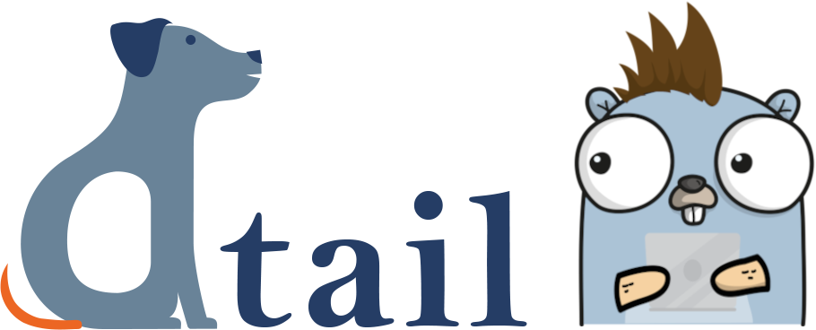
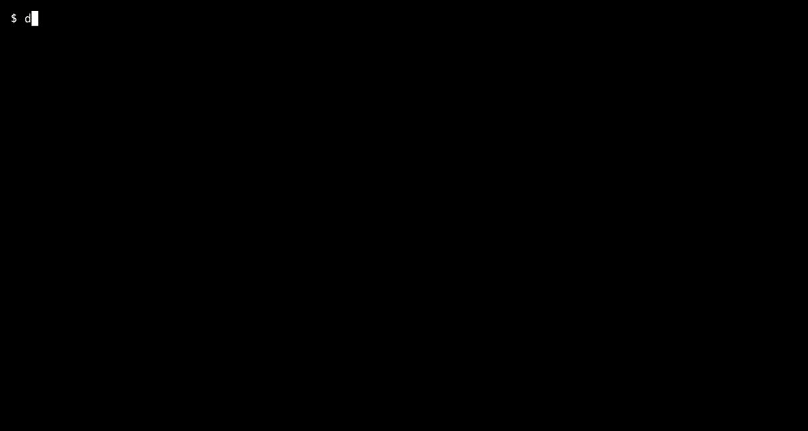

DTail
=====

     

DTail (distributed tail) is a DevOps tool written in Go for following (tailing), catting and grepping log files on many machines concurrently, including gzip and zstd compressed ones. It can also run distributed MapReduce aggregations over them.

* **Secure**: authorization and transport encryption use the SSH protocol. Per-user rules in the server configuration limit which files a user may read. A `dserver` built with Linux ACL support also checks the connecting user's file system permissions (see the [Installation Guide](doc/installation.md)).
* **Server**: `dserver` runs on every machine whose logs are read.
* **Clients**: `dtail` (follow), `dcat` (cat), `dgrep` (grep), `dmap` (MapReduce) and `dtailhealth` (health check) connect to many servers concurrently.
* **Interactive**: on a terminal `dtail` lets you change the filter or switch to a MapReduce query while it runs, and `dmap` without a query opens a query builder.
* **Serverless**: every client can also read local files without a `dserver`.

If you like what you see [look here for more examples](doc/examples.md)! You can also read through the [DTail Mimecast Engineering Blog Post](https://medium.com/mimecast-engineering/dtail-the-distributed-log-tail-program-79b8087904bb).

Installation and Usage
======================

* [Quick Starting Guide](doc/quickstart.md): install, start a `dserver`, run the first commands
* [Usage Examples](doc/examples.md)
* [DTail Documentation](doc/index.md): all documents

More
====

* [How to contribute](CONTRIBUTING.md)
* [Code of conduct](CODE_OF_CONDUCT.md)
* [Licenses](doc/licenses.md)

Credits
=======

* DTail was created by **Paul Buetow** *<pbuetow@mimecast.com>*
* Thank you [Mimecast](https://www.mimecast.com) for supporting this Open-Source project.
* Thank you to **Vlad-Marian Marian** for creating the DTail (dog) logo.
* The Gopher was generated at https://gopherize.me
